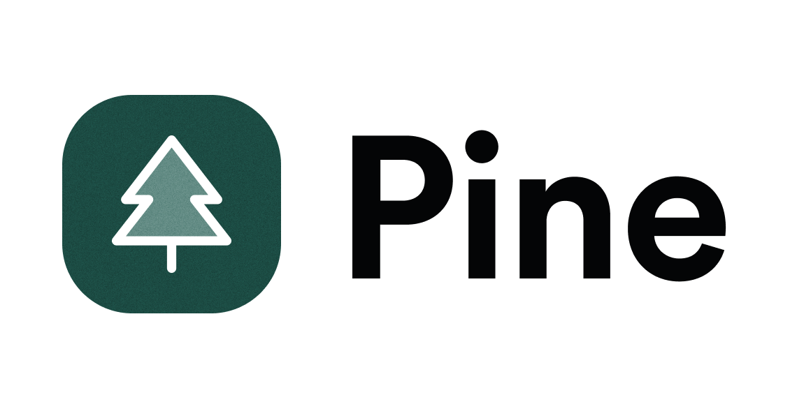

<picture>
  <source media="(prefers-color-scheme: dark)" srcset="./docs/assets/pine-logo-dark.png">
  <source media="(prefers-color-scheme: light)" srcset="./docs/assets/pine-logo.png">
  
</picture>

<h1 align="center">Pine Design System</h1>

> Pine is a design system that includes the building blocks necessary to create beautiful and accessible user interfaces and experiences. Our library of tools comes with design tokens in the form of CSS custom properties and web components that can be added to any existing project. Created by Kajabi.

## Setup

Pine can be added to any project via CDN. Add the following link and script tags to the `<head>`:

```html
<link rel="stylesheet" href="https://cdn.jsdelivr.net/npm/@pine-ds/core@[VERSION]/dist/pine-core/pine-core.css" />
<script type="module" src="https://cdn.jsdelivr.net/npm/@pine-ds/core@[VERSION]/dist/pine-core/pine-core.esm.js"></script>
<script nomodule src="https://cdn.jsdelivr.net/npm/@pine-ds/core@[VERSION]/dist/pine-core/pine-core.js"></script>
```

Replace `[VERSION]` with an exact version from [Releases](https://github.com/Kajabi/pine/releases), such as `4.11.0`. Don't use `latest`: it serves each new release as soon as it's published. See [Consumer guidance](./VERSIONING.md#consumer-guidance) for how to pin npm and CDN versions.

In React projects, install the components from npm:

```bash
npm install @pine-ds/react
```

`@pine-ds/react` doesn't load the stylesheet, so keep the `<link>` tag above, with `[VERSION]` set to the `@pine-ds/core` version in your lockfile. You don't need the two `<script>` tags. For other ways to load the stylesheet, and for other frameworks, see [Getting Started](https://pine-design-system.netlify.app/?path=/docs/introduction-getting-started--docs).

## Usage

As Pine components are web components, they can be used as simply as any other HTML tag. For example, to add an accent button to the project, add the following:

```html
<pds-button variant="accent">Pine Button</pds-button>
```

In React, import each component from `@pine-ds/react`. Component names are PascalCase, and props are camelCase:

```jsx
import { PdsCopytext } from '@pine-ds/react';

<PdsCopytext value="Copy this text" fullWidth />
```

For the full list of properties available for each component and more robust documentation, please see Pine's [Storybook](https://pine-design-system.netlify.app/).

## Changelogs

Stay up to date with the latest releases and updates across the Pine Design System:

- **Pine**: [View Releases](https://github.com/Kajabi/pine/releases)
- **Pine Icons**: [View Releases](https://github.com/Kajabi/pine-icons/releases)
- **Design Tokens**: [View Releases](https://github.com/Kajabi/ds-tokens/releases)

## Contribution

To learn more about contributing to Pine, please see the [Contribution](./CONTRIBUTING.md) docs.
