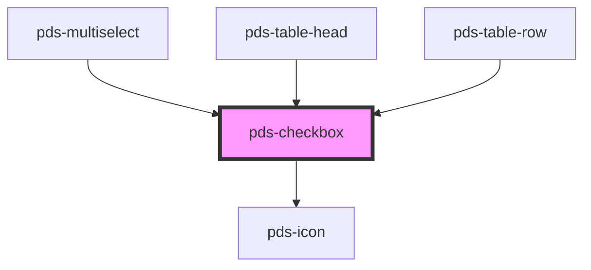

# pds-checkbox

<!-- Auto Generated Below -->

## Properties

| Property                   | Attribute        | Description                                                                                                                                                                                                   | Type                  | Default     |
| -------------------------- | ---------------- | ------------------------------------------------------------------------------------------------------------------------------------------------------------------------------------------------------------- | --------------------- | ----------- |
| `checked`                  | `checked`        | It determines whether or not the checkbox is checked.                                                                                                                                                         | `boolean`             | `false`     |
| `componentId` _(required)_ | `component-id`   | A unique identifier used for the underlying component `id` attribute and the label `for` attribute.                                                                                                           | `string`              | `undefined` |
| `disabled`                 | `disabled`       | It determines whether or not the checkbox is disabled.                                                                                                                                                        | `boolean`             | `undefined` |
| `errorMessage`             | `error-message`  | Displays an error message below the checkbox. It becomes the checkbox's accessible description only while `invalid` is set.                                                                                   | `string`              | `undefined` |
| `helperMessage`            | `helper-message` | Displays a message or hint below the checkbox.                                                                                                                                                                | `string`              | `undefined` |
| `hideLabel`                | `hide-label`     | Visually hides the label text for instances where only the checkbox should be displayed. Label remains accessible to assistive technology such as screen readers. Ignored when `variant` is `pill`.           | `boolean`             | `undefined` |
| `indeterminate`            | `indeterminate`  | Shows the checkbox as indeterminate, for a checkbox whose group is only partly selected. It's exposed to screen readers as mixed. Changing `checked` clears it. Has no visual style when `variant` is `pill`. | `boolean`             | `undefined` |
| `invalid`                  | `invalid`        | Determines whether or not the checkbox is invalid.                                                                                                                                                            | `boolean`             | `undefined` |
| `label`                    | `label`          | Text to be displayed as the checkbox label.                                                                                                                                                                   | `string`              | `undefined` |
| `name`                     | `name`           | String used for checkbox `name` attribute.                                                                                                                                                                    | `string`              | `undefined` |
| `required`                 | `required`       | It determines whether or not the checkbox is required.                                                                                                                                                        | `boolean`             | `undefined` |
| `value`                    | `value`          | The value of the checkbox that is submitted with a form.                                                                                                                                                      | `string`              | `undefined` |
| `variant`                  | `variant`        | Sets the style variant of the checkbox. `pill` renders the label as a pill-shaped choice; the native input still handles keyboard, form, and screen reader behavior.                                          | `"default" \| "pill"` | `'default'` |

## Events

| Event               | Description                                                                                                                                                                                                           | Type                                          |
| ------------------- | --------------------------------------------------------------------------------------------------------------------------------------------------------------------------------------------------------------------- | --------------------------------------------- |
| `pdsCheckboxChange` | Emitted when the user toggles the checkbox, carrying the `value` and the new `checked` state. Doesn't emit when `checked` is set programmatically.                                                                    | `CustomEvent<CheckboxChangeEventDetail<any>>` |
| `pdsCheckboxInput`  | Emitted when the user toggles the checkbox, just before `pdsCheckboxChange`, carrying the `value` and `checked`. `checked` is still the state from before the toggle, so read the new state from `pdsCheckboxChange`. | `CustomEvent<CheckboxChangeEventDetail<any>>` |

## Slots

| Slot      | Description                                                                                             |
| --------- | ------------------------------------------------------------------------------------------------------- |
| `"label"` | Content displayed as the checkbox label in place of the `label` text. Clicking it toggles the checkbox. |

## Dependencies

### Used by

 - [pds-multiselect](../pds-multiselect)
 - [pds-table-head](../pds-table/pds-table-head)
 - [pds-table-row](../pds-table/pds-table-row)

### Depends on

- pds-icon

### Graph

----------------------------------------------

