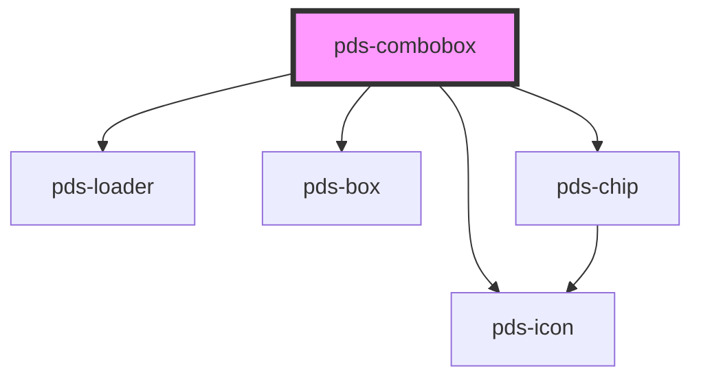

# pds-combobox

<!-- Auto Generated Below -->

## Properties

| Property                   | Attribute                | Description                                                                                                                                                                                                                                                                                                                                                                                                                                                                                                                                                                                                                                                                                                                                                                                                                                                                                                                                                                                                                        | Type                                                                                                      | Default              |
| -------------------------- | ------------------------ | ---------------------------------------------------------------------------------------------------------------------------------------------------------------------------------------------------------------------------------------------------------------------------------------------------------------------------------------------------------------------------------------------------------------------------------------------------------------------------------------------------------------------------------------------------------------------------------------------------------------------------------------------------------------------------------------------------------------------------------------------------------------------------------------------------------------------------------------------------------------------------------------------------------------------------------------------------------------------------------------------------------------------------------- | --------------------------------------------------------------------------------------------------------- | -------------------- |
| `asyncMethod`              | `async-method`           | HTTP method for async requests.                                                                                                                                                                                                                                                                                                                                                                                                                                                                                                                                                                                                                                                                                                                                                                                                                                                                                                                                                                                                    | `"GET" \| "POST"`                                                                                         | `'GET'`              |
| `asyncUrl`                 | `async-url`              | URL endpoint for async data fetching.                                                                                                                                                                                                                                                                                                                                                                                                                                                                                                                                                                                                                                                                                                                                                                                                                                                                                                                                                                                              | `string`                                                                                                  | `undefined`          |
| `chipDot`                  | `chip-dot`               | Whether a dot should be displayed on the chip trigger.                                                                                                                                                                                                                                                                                                                                                                                                                                                                                                                                                                                                                                                                                                                                                                                                                                                                                                                                                                             | `boolean`                                                                                                 | `false`              |
| `chipIcon`                 | `chip-icon`              | The name of the icon to display in the chip trigger.                                                                                                                                                                                                                                                                                                                                                                                                                                                                                                                                                                                                                                                                                                                                                                                                                                                                                                                                                                               | `string`                                                                                                  | `undefined`          |
| `chipLarge`                | `chip-large`             | Whether the chip trigger should be displayed in a larger size.                                                                                                                                                                                                                                                                                                                                                                                                                                                                                                                                                                                                                                                                                                                                                                                                                                                                                                                                                                     | `boolean`                                                                                                 | `false`              |
| `chipSentiment`            | `chip-sentiment`         | The sentiment for the chip trigger. Matches Pine chip sentiments.                                                                                                                                                                                                                                                                                                                                                                                                                                                                                                                                                                                                                                                                                                                                                                                                                                                                                                                                                                  | `"accent" \| "brand" \| "danger" \| "info" \| "neutral" \| "solid" \| "subtle" \| "success" \| "warning"` | `'neutral'`          |
| `componentId` _(required)_ | `component-id`           | A unique identifier used for the underlying component `id` attribute.                                                                                                                                                                                                                                                                                                                                                                                                                                                                                                                                                                                                                                                                                                                                                                                                                                                                                                                                                              | `string`                                                                                                  | `undefined`          |
| `customOptionLayouts`      | `custom-option-layouts`  | Enable custom layout content for options. Options with data-layout attribute will render their HTML content. ⚠️ Security Warning: Only use with trusted content. Basic XSS protection is applied, but avoid user-generated content.                                                                                                                                                                                                                                                                                                                                                                                                                                                                                                                                                                                                                                                                                                                                                                                                | `boolean`                                                                                                 | `false`              |
| `customTriggerContent`     | `custom-trigger-content` | Enable custom layout content for the button trigger via the trigger-content slot. When true, uses slot content for initial state but updates dynamically with selected option layout. ⚠️ Security Warning: Only use with trusted content. Basic XSS protection is applied, but avoid user-generated content.                                                                                                                                                                                                                                                                                                                                                                                                                                                                                                                                                                                                                                                                                                                       | `boolean`                                                                                                 | `false`              |
| `debounce`                 | `debounce`               | Debounce delay in milliseconds for search/fetch.                                                                                                                                                                                                                                                                                                                                                                                                                                                                                                                                                                                                                                                                                                                                                                                                                                                                                                                                                                                   | `number`                                                                                                  | `300`                |
| `disabled`                 | `disabled`               | If true, the combobox is disabled.                                                                                                                                                                                                                                                                                                                                                                                                                                                                                                                                                                                                                                                                                                                                                                                                                                                                                                                                                                                                 | `boolean`                                                                                                 | `false`              |
| `drillInBackLabel`         | `drill-in-back-label`    | Accessible prefix for the row that returns to the group list when `group-display` is `drill-in`, read before the open group's label. Pass a translated string to localize it; defaults to English.                                                                                                                                                                                                                                                                                                                                                                                                                                                                                                                                                                                                                                                                                                                                                                                                                                 | `string`                                                                                                  | `'Back'`             |
| `dropdownMount`            | `dropdown-mount`         | Where to mount the dropdown listbox (`host` or `body`, sometimes called “append to body”). Use `body` inside scrollable containers (for example modals) so the list is not clipped by `overflow: hidden` ancestors. The portal is appended to the nearest `<dialog>` when present (including `pds-modal` / `showModal()`), using a composed ascent so shadow DOM and slot boundaries do not hide the dialog from discovery; otherwise it is appended to `document.body`. Keyboard focus stays on the trigger, or moves to the panel's own search field, so modal focus traps keep working. The mounted dropdown renders in its own shadow root with the combobox's styles, so it needs no global CSS and page CSS can't reach it: customize it with custom properties on `pds-combobox`. Its reading direction, language, theme and custom properties are taken from the combobox when it opens. Custom `empty` and `loading` slots are not supported when `body` is used; the default empty and loading content is shown instead. | `"body" \| "host"`                                                                                        | `'host'`             |
| `dropdownPlacement`        | `dropdown-placement`     | Placement of the dropdown relative to the trigger.                                                                                                                                                                                                                                                                                                                                                                                                                                                                                                                                                                                                                                                                                                                                                                                                                                                                                                                                                                                 | `"bottom-end" \| "bottom-start" \| "top-end" \| "top-start"`                                              | `'bottom-start'`     |
| `dropdownWidth`            | `dropdown-width`         | Width of the dropdown. Any valid CSS width value.                                                                                                                                                                                                                                                                                                                                                                                                                                                                                                                                                                                                                                                                                                                                                                                                                                                                                                                                                                                  | `string`                                                                                                  | `'236px'`            |
| `errorMessage`             | `error-message`          | Error message to display.                                                                                                                                                                                                                                                                                                                                                                                                                                                                                                                                                                                                                                                                                                                                                                                                                                                                                                                                                                                                          | `string`                                                                                                  | `undefined`          |
| `fetchTimeout`             | `fetch-timeout`          | Timeout in milliseconds for async fetch requests.                                                                                                                                                                                                                                                                                                                                                                                                                                                                                                                                                                                                                                                                                                                                                                                                                                                                                                                                                                                  | `number`                                                                                                  | `30000`              |
| `flyoutMaxWidth`           | `flyout-max-width`       | Maximum width of a group's flyout when `group-display` is `flyout`. Any valid CSS width value.                                                                                                                                                                                                                                                                                                                                                                                                                                                                                                                                                                                                                                                                                                                                                                                                                                                                                                                                     | `string`                                                                                                  | `'380px'`            |
| `flyoutMinWidth`           | `flyout-min-width`       | Minimum width of a group's flyout when `group-display` is `flyout`. Any valid CSS width value. The flyout is as wide as its options, between this and `flyout-max-width`.                                                                                                                                                                                                                                                                                                                                                                                                                                                                                                                                                                                                                                                                                                                                                                                                                                                          | `string`                                                                                                  | `'280px'`            |
| `formatResult`             | --                       | Function to format async results. Receives raw API response item.                                                                                                                                                                                                                                                                                                                                                                                                                                                                                                                                                                                                                                                                                                                                                                                                                                                                                                                                                                  | `(item: unknown) => ComboboxOption`                                                                       | `undefined`          |
| `groupDisplay`             | `group-display`          | How option groups (`<optgroup>`, or the `group` field of `options`) are shown in the dropdown. `inline` lists each group's label above its options. `flyout` lists the groups, and opens a group's options in a panel beside it on hover or click; while searching, the matching options are listed under their group labels, and search also matches group labels. `flyout` groups by `<optgroup>` (or `group`) only: options under a `<pds-text>` heading are listed ungrouped. `drill-in` lists the groups too, but a click replaces the list with that group's options and a row back to the groups; use it where nothing can open beside the dropdown, such as a side panel. `flyout` falls back to `drill-in` when there is no room for a flyout on either side.                                                                                                                                                                                                                                                             | `"drill-in" \| "flyout" \| "inline"`                                                                      | `'inline'`           |
| `helperMessage`            | `helper-message`         | Helper message to display below the combobox.                                                                                                                                                                                                                                                                                                                                                                                                                                                                                                                                                                                                                                                                                                                                                                                                                                                                                                                                                                                      | `string`                                                                                                  | `undefined`          |
| `hideLabel`                | `hide-label`             | Visually hides the label text for instances where only the combobox should be displayed. The visible `<label>` is omitted (same pattern as `pds-select`) so label spacing does not reserve layout; the trigger uses `aria-label` so the name stays available to assistive technology.                                                                                                                                                                                                                                                                                                                                                                                                                                                                                                                                                                                                                                                                                                                                              | `boolean`                                                                                                 | `false`              |
| `invalid`                  | `invalid`                | If true, the combobox is in an invalid state.                                                                                                                                                                                                                                                                                                                                                                                                                                                                                                                                                                                                                                                                                                                                                                                                                                                                                                                                                                                      | `boolean`                                                                                                 | `undefined`          |
| `label`                    | `label`                  | Text to be displayed as the combobox label.                                                                                                                                                                                                                                                                                                                                                                                                                                                                                                                                                                                                                                                                                                                                                                                                                                                                                                                                                                                        | `string`                                                                                                  | `undefined`          |
| `loading`                  | `loading`                | Whether the component is currently loading async options.                                                                                                                                                                                                                                                                                                                                                                                                                                                                                                                                                                                                                                                                                                                                                                                                                                                                                                                                                                          | `boolean`                                                                                                 | `false`              |
| `maxHeight`                | `max-height`             | Maximum height of the dropdown. Can be any valid CSS height value (e.g., '200px', '10rem'). When content exceeds this height, the dropdown will scroll.                                                                                                                                                                                                                                                                                                                                                                                                                                                                                                                                                                                                                                                                                                                                                                                                                                                                            | `string`                                                                                                  | `undefined`          |
| `mode`                     | `mode`                   | Determines the combobox mode: 'filter' (filter options as you type) or 'select-only' (show all options). In filter mode, reopening the menu while the input still shows the label of the selected option temporarily lists all options until you type (so you can switch to a different choice without clearing the field first).                                                                                                                                                                                                                                                                                                                                                                                                                                                                                                                                                                                                                                                                                                  | `"filter" \| "select-only"`                                                                               | `'filter'`           |
| `name`                     | `name`                   | The name of the form control. Submitted with the form as part of a name/value pair.                                                                                                                                                                                                                                                                                                                                                                                                                                                                                                                                                                                                                                                                                                                                                                                                                                                                                                                                                | `string`                                                                                                  | `undefined`          |
| `noOptionsFoundLabel`      | `no-options-found-label` | Text shown when no options match the search. Pass a translated string to localize it; defaults to English.                                                                                                                                                                                                                                                                                                                                                                                                                                                                                                                                                                                                                                                                                                                                                                                                                                                                                                                         | `string`                                                                                                  | `'No options found'` |
| `options`                  | --                       | Options provided externally (for consumer-managed async).                                                                                                                                                                                                                                                                                                                                                                                                                                                                                                                                                                                                                                                                                                                                                                                                                                                                                                                                                                          | `ComboboxOption[]`                                                                                        | `undefined`          |
| `panelSearch`              | `panel-search`           | Shows a search field at the top of the dropdown for the `button` and `chip` triggers, which can't be typed into. Search filters the options the same way typing in the `input` trigger does; in a grouped display it also matches group labels.                                                                                                                                                                                                                                                                                                                                                                                                                                                                                                                                                                                                                                                                                                                                                                                    | `boolean`                                                                                                 | `false`              |
| `placeholder`              | `placeholder`            | Placeholder text for the input field.                                                                                                                                                                                                                                                                                                                                                                                                                                                                                                                                                                                                                                                                                                                                                                                                                                                                                                                                                                                              | `string`                                                                                                  | `undefined`          |
| `searchOptionsLabel`       | `search-options-label`   | Accessible label for the search input inside the dropdown panel (`panel-search`). Pass a translated string to localize it; defaults to English.                                                                                                                                                                                                                                                                                                                                                                                                                                                                                                                                                                                                                                                                                                                                                                                                                                                                                    | `string`                                                                                                  | `'Search options'`   |
| `searchPlaceholder`        | `search-placeholder`     | Placeholder text for the search input inside the dropdown panel (`panel-search`). Pass a translated string to localize it; defaults to English.                                                                                                                                                                                                                                                                                                                                                                                                                                                                                                                                                                                                                                                                                                                                                                                                                                                                                    | `string`                                                                                                  | `'Find...'`          |
| `trigger`                  | `trigger`                | Determines the combobox trigger: 'input' (editable input), 'button' (button-like, non-editable), or 'chip' (chip-like, non-editable).                                                                                                                                                                                                                                                                                                                                                                                                                                                                                                                                                                                                                                                                                                                                                                                                                                                                                              | `"button" \| "chip" \| "input"`                                                                           | `'input'`            |
| `triggerShape`             | `trigger-shape`          | The shape of the button trigger. Use 'input' to render the trigger with input-like styling (subtle border radius, input height) for use in form or filter rows alongside PdsSelect and PdsMultiselect.                                                                                                                                                                                                                                                                                                                                                                                                                                                                                                                                                                                                                                                                                                                                                                                                                             | `"input" \| "pill"`                                                                                       | `'pill'`             |
| `triggerVariant`           | `trigger-variant`        | The visual variant for the button trigger. Matches Pine button variants.                                                                                                                                                                                                                                                                                                                                                                                                                                                                                                                                                                                                                                                                                                                                                                                                                                                                                                                                                           | `"accent" \| "destructive" \| "primary" \| "secondary"`                                                   | `'secondary'`        |
| `triggerWidth`             | `trigger-width`          | Width of the trigger (button or input). Any valid CSS width value.                                                                                                                                                                                                                                                                                                                                                                                                                                                                                                                                                                                                                                                                                                                                                                                                                                                                                                                                                                 | `string`                                                                                                  | `'fit-content'`      |
| `truncate`                 | `truncate`               | Determines whether the button trigger's label and the option labels should truncate and display with an ellipsis. When a label overflows, a `title` showing the full label will appear on hover.                                                                                                                                                                                                                                                                                                                                                                                                                                                                                                                                                                                                                                                                                                                                                                                                                                   | `boolean`                                                                                                 | `false`              |
| `value`                    | `value`                  | The value of the combobox input.                                                                                                                                                                                                                                                                                                                                                                                                                                                                                                                                                                                                                                                                                                                                                                                                                                                                                                                                                                                                   | `string`                                                                                                  | `''`                 |

## Events

| Event                    | Description                                           | Type                                          |
| ------------------------ | ----------------------------------------------------- | --------------------------------------------- |
| `pdsComboboxChange`      | Emitted when the value changes.                       | `CustomEvent<{ value: string; }>`             |
| `pdsComboboxLoadOptions` | Emitted to request more options (pagination).         | `CustomEvent<ComboboxLoadOptionsEventDetail>` |
| `pdsComboboxSearch`      | Emitted on search input (for consumer-managed async). | `CustomEvent<ComboboxSearchEventDetail>`      |

## Methods

### `clear() => Promise<void>`

Clears the selected value and resets the component. Works while disabled too, as setting a
native control's value from script does.

#### Returns

Type: `Promise<void>`

### `getSelectedValue() => Promise<string | null>`

Gets the value of the currently selected option.

#### Returns

Type: `Promise<string>`

### `setFocus() => Promise<void>`

Sets focus on the native input element.

#### Returns

Type: `Promise<void>`

## Slots

| Slot                | Description                                                             |
| ------------------- | ----------------------------------------------------------------------- |
| `"empty"`           | Custom empty state message when no options match                        |
| `"loading"`         | Custom loading indicator                                                |
| `"option"`          | Option elements for the combobox dropdown                               |
| `"trigger-content"` | Custom content for the button trigger when customTriggerContent is true |

## Shadow Parts

| Part               | Description |
| ------------------ | ----------- |
| `"button-trigger"` |             |
| `"chip-trigger"`   |             |
| `"combobox"`       |             |
| `"input"`          |             |

## Dependencies

### Depends on

- [pds-loader](../pds-loader)
- pds-icon
- [pds-box](../pds-box)
- [pds-chip](../pds-chip)

### Graph

----------------------------------------------

