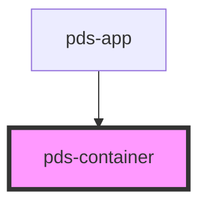

# pds-container

<!-- Auto Generated Below -->

## Properties

| Property   | Attribute  | Description                                                                                                                                                                                                                                      | Type                                        | Default     |
| ---------- | ---------- | ------------------------------------------------------------------------------------------------------------------------------------------------------------------------------------------------------------------------------------------------ | ------------------------------------------- | ----------- |
| `centered` | `centered` | If `true`, the container is centered horizontally using `margin-inline: auto`.                                                                                                                                                                   | `boolean`                                   | `true`      |
| `size`     | `size`     | Sets the maximum width of the container. Accepts a named size token (`'sm'` 340px, `'md'` 520px, `'lg'` 700px, `'xl'` 1064px, `'full'` 1440px) or any valid CSS length value (e.g. `'640px'`, `'50rem'`). When omitted, no max-width is applied. | `string`                                    | `undefined` |
| `tag`      | `tag`      | Sets the semantic HTML tag rendered as the inner container element.                                                                                                                                                                              | `"article" \| "div" \| "main" \| "section"` | `'div'`     |

## Slots

| Slot          | Description                                  |
| ------------- | -------------------------------------------- |
| `"(default)"` | The content to display inside the container. |

## Shadow Parts

| Part          | Description                          |
| ------------- | ------------------------------------ |
| `"container"` | The inner semantic container element |

## Dependencies

### Used by

 - [pds-app](../pds-app)

### Graph

----------------------------------------------

