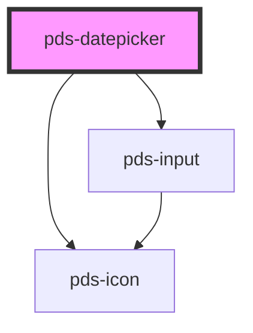

# pds-datepicker

<!-- Auto Generated Below -->

## Overview

A field for one date, or in range mode a start and end date, with a calendar to pick from.
The value is `YYYY-MM-DD`, or `YYYY-MM-DD/YYYY-MM-DD` for a range; with the time picker, each
date carries a time, as `YYYY-MM-DDTHH:mm`.

## Properties

| Property                   | Attribute              | Description                                                                                                                                                                                                                                                                                                                                                                                                                                                                                       | Type                                                                                                                                                                 | Default                               |
| -------------------------- | ---------------------- | ------------------------------------------------------------------------------------------------------------------------------------------------------------------------------------------------------------------------------------------------------------------------------------------------------------------------------------------------------------------------------------------------------------------------------------------------------------------------------------------------- | -------------------------------------------------------------------------------------------------------------------------------------------------------------------- | ------------------------------------- |
| `applyLabel`               | `apply-label`          | Accessible label for the button that applies the chosen dates.                                                                                                                                                                                                                                                                                                                                                                                                                                    | `string`                                                                                                                                                             | `'Apply'`                             |
| `cancelLabel`              | `cancel-label`         | Accessible label for the button that closes the calendar without changing the dates.                                                                                                                                                                                                                                                                                                                                                                                                              | `string`                                                                                                                                                             | `'Cancel'`                            |
| `clearLabel`               | `clear-label`          | Accessible label for the button that empties the field, when `clearable` is set.                                                                                                                                                                                                                                                                                                                                                                                                                  | `string`                                                                                                                                                             | `'Clear'`                             |
| `clearable`                | `clearable`            | Replaces the Cancel button with a Clear button, which empties the field. Shown with the range mode and time picker buttons.                                                                                                                                                                                                                                                                                                                                                                       | `boolean`                                                                                                                                                            | `false`                               |
| `componentId` _(required)_ | `component-id`         | A unique identifier used for the underlying component `id` attribute.                                                                                                                                                                                                                                                                                                                                                                                                                             | `string`                                                                                                                                                             | `undefined`                           |
| `customRangeLabel`         | `custom-range-label`   | The label of the presets entry that stands for a range of your own. Range mode with presets only.                                                                                                                                                                                                                                                                                                                                                                                                 | `string`                                                                                                                                                             | `'Custom range'`                      |
| `disabled`                 | `disabled`             | Determines whether or not the datepicker is disabled.                                                                                                                                                                                                                                                                                                                                                                                                                                             | `boolean`                                                                                                                                                            | `undefined`                           |
| `endTimeLabel`             | `end-time-label`       | Accessible label for the end time, in range mode with the time picker.                                                                                                                                                                                                                                                                                                                                                                                                                            | `string`                                                                                                                                                             | `'End time'`                          |
| `errorMessage`             | `error-message`        | Specifies the error message and provides an error-themed treatment to the field.                                                                                                                                                                                                                                                                                                                                                                                                                  | `string`                                                                                                                                                             | `undefined`                           |
| `firstDayOfWeek`           | `first-day-of-week`    | The first day of the week in the calendar, from `0` (Sunday) to `6` (Saturday). Defaults to the locale's first day where the browser reports it, otherwise Sunday.                                                                                                                                                                                                                                                                                                                                | `number`                                                                                                                                                             | `undefined`                           |
| `format`                   | `format`               | How the field shows dates and reads typed ones, as tokens: `YYYY`, `MMMM` or `MMM` (month name, in the locale), `MM` or `M` (month), `DD` or `D` (day), and with the time picker `HH` or `H` (24-hour), `hh` or `h` (12-hour), `mm` and `A` (AM/PM, in the locale), as `MM/DD/YYYY`, `MMM D, YYYY` or `D.M.YYYY h:mm A`. Put literal text in brackets, as `[Due] D/M/YYYY`. The value and the change event stay ISO (`YYYY-MM-DD`), whatever the format. Typed ISO dates are always accepted too. | `string`                                                                                                                                                             | `'YYYY-MM-DD'`                        |
| `fullWidth`                | `full-width`           | Determines whether or not the datepicker takes full width of its container.                                                                                                                                                                                                                                                                                                                                                                                                                       | `boolean`                                                                                                                                                            | `undefined`                           |
| `helperMessage`            | `helper-message`       | Displays a message or hint below the field.                                                                                                                                                                                                                                                                                                                                                                                                                                                       | `string`                                                                                                                                                             | `undefined`                           |
| `hideLabel`                | `hide-label`           | Visually hides the label text for instances where only the field should be displayed. Label remains accessible to assistive technology such as screen readers.                                                                                                                                                                                                                                                                                                                                    | `boolean`                                                                                                                                                            | `undefined`                           |
| `hourLabel`                | `hour-label`           | Accessible label for the hour in the time picker.                                                                                                                                                                                                                                                                                                                                                                                                                                                 | `string`                                                                                                                                                             | `'Hour'`                              |
| `invalid`                  | `invalid`              | Determines whether or not the datepicker is invalid or throws an error.                                                                                                                                                                                                                                                                                                                                                                                                                           | `boolean`                                                                                                                                                            | `undefined`                           |
| `invalidDateMessage`       | `invalid-date-message` | The validation message the form reports when the typed text isn't a date that can be picked.                                                                                                                                                                                                                                                                                                                                                                                                      | `string`                                                                                                                                                             | `'Enter a date in the format shown.'` |
| `label`                    | `label`                | Text to be displayed as the datepicker label.                                                                                                                                                                                                                                                                                                                                                                                                                                                     | `string`                                                                                                                                                             | `undefined`                           |
| `locale`                   | `locale`               | The locale used for month and weekday names, as a BCP 47 language tag such as `en-US` or `fr`. Defaults to the nearest `lang` attribute, then the browser's language.                                                                                                                                                                                                                                                                                                                             | `string`                                                                                                                                                             | `undefined`                           |
| `max`                      | `max`                  | The latest date that can be picked, as `YYYY-MM-DD`.                                                                                                                                                                                                                                                                                                                                                                                                                                              | `string`                                                                                                                                                             | `undefined`                           |
| `min`                      | `min`                  | The earliest date that can be picked, as `YYYY-MM-DD`.                                                                                                                                                                                                                                                                                                                                                                                                                                            | `string`                                                                                                                                                             | `undefined`                           |
| `minuteIncrement`          | `minute-increment`     | The minutes the time picker steps by, such as `15` or `30`.                                                                                                                                                                                                                                                                                                                                                                                                                                       | `number`                                                                                                                                                             | `1`                                   |
| `minuteLabel`              | `minute-label`         | Accessible label for the minute in the time picker.                                                                                                                                                                                                                                                                                                                                                                                                                                               | `string`                                                                                                                                                             | `'Minute'`                            |
| `monthLabel`               | `month-label`          | Accessible label for the month dropdown, when `show-dropdowns` is set.                                                                                                                                                                                                                                                                                                                                                                                                                            | `string`                                                                                                                                                             | `'Month'`                             |
| `name`                     | `name`                 | Specifies the name. Submitted with the form name/value pair.                                                                                                                                                                                                                                                                                                                                                                                                                                      | `string`                                                                                                                                                             | `undefined`                           |
| `nextMonthLabel`           | `next-month-label`     | Accessible label for the button that shows the next month.                                                                                                                                                                                                                                                                                                                                                                                                                                        | `string`                                                                                                                                                             | `'Next month'`                        |
| `periodLabel`              | `period-label`         | Accessible label for the AM or PM choice in the time picker, in locales with a 12-hour clock.                                                                                                                                                                                                                                                                                                                                                                                                     | `string`                                                                                                                                                             | `'AM or PM'`                          |
| `placeholder`              | `placeholder`          | Specifies a short hint that describes the expected value of the field. Defaults to the format the field takes, such as `YYYY-MM-DD`.                                                                                                                                                                                                                                                                                                                                                              | `string`                                                                                                                                                             | `undefined`                           |
| `placement`                | `placement`            | The placement of the calendar relative to the field.                                                                                                                                                                                                                                                                                                                                                                                                                                              | `"bottom" \| "bottom-end" \| "bottom-start" \| "left" \| "left-end" \| "left-start" \| "right" \| "right-end" \| "right-start" \| "top" \| "top-end" \| "top-start"` | `'bottom-start'`                      |
| `presets`                  | `presets`              | Ranges listed beside the calendar in range mode. A comma-separated list of built-in keys (`today`, `yesterday`, `last-7-days`, `last-30-days`, `last-90-days`, `this-month`, `last-month`, `this-quarter`, `last-quarter`, `this-year`, `last-year`, `year-to-date`, `last-12-months`), or an array of `{ key, label?, start?, end? }` to relabel built-ins or add your own.                                                                                                                      | `DatepickerPreset[] \| string`                                                                                                                                       | `undefined`                           |
| `previousMonthLabel`       | `previous-month-label` | Accessible label for the button that shows the previous month.                                                                                                                                                                                                                                                                                                                                                                                                                                    | `string`                                                                                                                                                             | `'Previous month'`                    |
| `range`                    | `range`                | Picks a range: a start and an end date, from two months side by side, applied with the Apply button. The value is `YYYY-MM-DD/YYYY-MM-DD`.                                                                                                                                                                                                                                                                                                                                                        | `boolean`                                                                                                                                                            | `false`                               |
| `readonly`                 | `readonly`             | Determines whether or not the datepicker is readonly.                                                                                                                                                                                                                                                                                                                                                                                                                                             | `boolean`                                                                                                                                                            | `undefined`                           |
| `required`                 | `required`             | Determines whether or not the datepicker is required.                                                                                                                                                                                                                                                                                                                                                                                                                                             | `boolean`                                                                                                                                                            | `undefined`                           |
| `showDropdowns`            | `show-dropdowns`       | Shows month and year dropdowns in place of the month heading, for jumping far, as to a birth year.                                                                                                                                                                                                                                                                                                                                                                                                | `boolean`                                                                                                                                                            | `false`                               |
| `startTimeLabel`           | `start-time-label`     | Accessible label for the start time, in range mode with the time picker.                                                                                                                                                                                                                                                                                                                                                                                                                          | `string`                                                                                                                                                             | `'Start time'`                        |
| `timeLabel`                | `time-label`           | Accessible label for the time, with the time picker and a single date.                                                                                                                                                                                                                                                                                                                                                                                                                            | `string`                                                                                                                                                             | `'Time'`                              |
| `timePicker`               | `time-picker`          | Adds hour and minute pickers below the calendar, and the value carries the time as `YYYY-MM-DDTHH:mm`. The dates are applied with the Apply button.                                                                                                                                                                                                                                                                                                                                               | `boolean`                                                                                                                                                            | `false`                               |
| `triggerLabel`             | `trigger-label`        | Accessible label for the button that opens the calendar. The selected date is added to it.                                                                                                                                                                                                                                                                                                                                                                                                        | `string`                                                                                                                                                             | `'Choose date'`                       |
| `value`                    | `value`                | The selected date as `YYYY-MM-DD`, or in range mode the range as `YYYY-MM-DD/YYYY-MM-DD`; with the time picker, each date as `YYYY-MM-DDTHH:mm`. An empty string when nothing is selected.                                                                                                                                                                                                                                                                                                        | `string`                                                                                                                                                             | `''`                                  |
| `yearLabel`                | `year-label`           | Accessible label for the year dropdown, when `show-dropdowns` is set.                                                                                                                                                                                                                                                                                                                                                                                                                             | `string`                                                                                                                                                             | `'Year'`                              |

## Events

| Event                 | Description                                                                                                   | Type                                       |
| --------------------- | ------------------------------------------------------------------------------------------------------------- | ------------------------------------------ |
| `pdsBlur`             | Emitted when the datepicker loses focus: when focus leaves the field and the calendar.                        | `CustomEvent<FocusEvent>`                  |
| `pdsDatepickerChange` | Emitted when the value changes.  This event will not emit when programmatically setting the `value` property. | `CustomEvent<DatepickerChangeEventDetail>` |
| `pdsFocus`            | Emitted when the datepicker gains focus: when focus moves into the field or the calendar from outside.        | `CustomEvent<FocusEvent>`                  |

## Methods

### `close() => Promise<void>`

Closes the calendar.

#### Returns

Type: `Promise<void>`

### `open() => Promise<void>`

Opens the calendar and moves focus to the selected day, or today.

#### Returns

Type: `Promise<void>`

### `setFocus() => Promise<void>`

Sets focus on the datepicker's text field.

#### Returns

Type: `Promise<void>`

## Shadow Parts

| Part         | Description |
| ------------ | ----------- |
| `"calendar"` |             |
| `"presets"`  |             |

## Dependencies

### Depends on

- pds-icon
- [pds-input](../pds-input)

### Graph

----------------------------------------------

