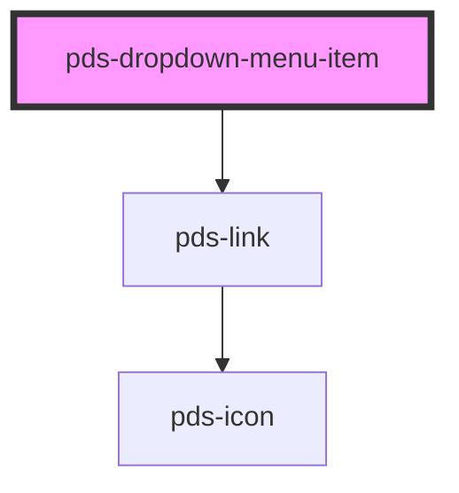

# pds-dropdown-menu-item

An item inside a `pds-dropdown-menu`. Renders a button by default, or a link when `href` is set. An `informational` item renders text that can't be activated, even when `href` is set.

<!-- Auto Generated Below -->

## Properties

| Property        | Attribute        | Description                                                                                                                                                                                                                                                                                           | Type                                         | Default     |
| --------------- | ---------------- | ----------------------------------------------------------------------------------------------------------------------------------------------------------------------------------------------------------------------------------------------------------------------------------------------------- | -------------------------------------------- | ----------- |
| `componentId`   | `component-id`   | A unique identifier used for the underlying component `id` attribute.                                                                                                                                                                                                                                 | `string`                                     | `undefined` |
| `destructive`   | `destructive`    | Determines whether or not the dropdown menu item is destructive.                                                                                                                                                                                                                                      | `boolean`                                    | `false`     |
| `disabled`      | `disabled`       | Determines whether or not the dropdown menu item is disabled.                                                                                                                                                                                                                                         | `boolean`                                    | `false`     |
| `download`      | `download`       | Prompts the user to save the linked URL instead of navigating to it. It can be used without a value to download with the default filename, or with a string value to suggest a specific filename for the download. Only applies when href is set. Ignored when `informational` is set.                | `string`                                     | `undefined` |
| `external`      | `external`       | Shows the external-link (launch) icon. Opens in a new tab unless `target` says otherwise. Only applies when href is set. Ignored when `informational` is set.                                                                                                                                         | `boolean`                                    | `false`     |
| `externalLabel` | `external-label` | Accessible label for the icon that `external` shows, passed to the inner `pds-link` and appended to the item's name. It isn't announced when `target` keeps the link in the same tab. Pass a translated string to localize it; defaults to English. Pass an empty string to make the icon decorative. | `string`                                     | `undefined` |
| `href`          | `href`           | If provided, renders the dropdown menu item as an anchor (`<a>`) element instead of a button. Ignored when `informational` is set.                                                                                                                                                                    | `string`                                     | `undefined` |
| `informational` | `informational`  | Determines whether or not the dropdown menu item is informational: text that the arrow keys reach but that can't be activated. Takes precedence over `href` and `destructive`. Screen readers announce it as dimmed or unavailable, the same way as a disabled item.                                  | `boolean`                                    | `false`     |
| `target`        | `target`         | Specifies where to open the linked document when href is provided. Overrides the new-tab default of `external`; the icon still shows. Only applies when href is set. Ignored when `informational` is set.                                                                                             | `"_blank" \| "_parent" \| "_self" \| "_top"` | `undefined` |

## Events

| Event      | Description                                     | Type                                                                                         |
| ---------- | ----------------------------------------------- | -------------------------------------------------------------------------------------------- |
| `pdsClick` | Emitted when the dropdown menu item is clicked. | `CustomEvent<{ itemIndex: number; item: HTMLPdsDropdownMenuItemElement; content: string; }>` |

## Methods

### `clickItem() => Promise<void>`

Trigger the click event

#### Returns

Type: `Promise<void>`

## Shadow Parts

| Part       | Description                                                                                            |
| ---------- | ------------------------------------------------------------------------------------------------------ |
| `"button"` | Exposes the item's inner element for styling. Appears on button and informational items, not on links. |

## Dependencies

### Depends on

- [pds-link](../../pds-link)

### Graph

----------------------------------------------

