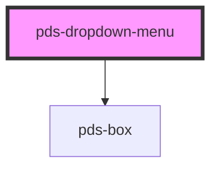

# pds-dropdown-menu

Reveals a list of actions from a button trigger, based on the WAI-ARIA Menu Button pattern.

<!-- Auto Generated Below -->

## Properties

| Property      | Attribute      | Description                                                                                                                          | Type                                                                                                                                                                 | Default          |
| ------------- | -------------- | ------------------------------------------------------------------------------------------------------------------------------------ | -------------------------------------------------------------------------------------------------------------------------------------------------------------------- | ---------------- |
| `componentId` | `component-id` | A unique identifier for this component instance. Does not set the host element's `id` attribute — set `id` directly if you need one. | `string`                                                                                                                                                             | `undefined`      |
| `placement`   | `placement`    | The placement of the dropdown panel relative to the trigger.                                                                         | `"bottom" \| "bottom-end" \| "bottom-start" \| "left" \| "left-end" \| "left-start" \| "right" \| "right-end" \| "right-start" \| "top" \| "top-end" \| "top-start"` | `'bottom-start'` |

## Slots

| Slot          | Description                                                                                                                                                                                 |
| ------------- | ------------------------------------------------------------------------------------------------------------------------------------------------------------------------------------------- |
| `"(default)"` | The menu items: `pds-dropdown-menu-item` and `pds-dropdown-menu-separator` elements, or raw `<a>` and `<button>` elements.                                                                  |
| `"header"`    | Non-interactive content displayed above the menu items inside the dropdown panel. It renders outside the menu role, so assistive tech reads it as plain content rather than as a menu item. |
| `"trigger"`   | The trigger element for the dropdown menu. It receives `aria-expanded` and `aria-haspopup`, so slot the focusable control itself, such as a `pds-button`, not a wrapper around it.          |

## Shadow Parts

| Part           | Description                                      |
| -------------- | ------------------------------------------------ |
| `"menu-panel"` | Exposes the dropdown menu container for styling. |

## Dependencies

### Depends on

- [pds-box](../pds-box)

### Graph

----------------------------------------------

