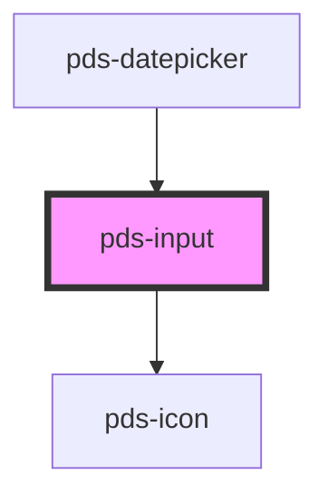

# pds-input

<!-- Auto Generated Below -->

## Properties

| Property                   | Attribute        | Description                                                                                                                                                                                                                              | Type               | Default     |
| -------------------------- | ---------------- | ---------------------------------------------------------------------------------------------------------------------------------------------------------------------------------------------------------------------------------------- | ------------------ | ----------- |
| `autocomplete`             | `autocomplete`   | Specifies if and how the browser provides `autocomplete` assistance for the field.                                                                                                                                                       | `string`           | `undefined` |
| `componentId` _(required)_ | `component-id`   | A unique identifier used for the underlying component `id` attribute.                                                                                                                                                                    | `string`           | `undefined` |
| `debounce`                 | `debounce`       | Sets the number of milliseconds to wait after each input event before emitting `pdsInput`.                                                                                                                                               | `number`           | `undefined` |
| `disabled`                 | `disabled`       | Determines whether or not the input field is disabled.                                                                                                                                                                                   | `boolean`          | `undefined` |
| `errorMessage`             | `error-message`  | Displays an error message below the input and gives the field error styling. It becomes the input's accessible description only while `invalid` is set.                                                                                  | `string`           | `undefined` |
| `fullWidth`                | `full-width`     | Determines whether or not the input field takes full width of its container.                                                                                                                                                             | `boolean`          | `undefined` |
| `helperMessage`            | `helper-message` | Displays a message or hint below the input field.                                                                                                                                                                                        | `string`           | `undefined` |
| `hideLabel`                | `hide-label`     | Visually hides the label text for instances where only the input should be displayed. Label remains accessible to assistive technology such as screen readers. Note: When true, the action slot is also hidden to maintain a minimal UI. | `boolean`          | `undefined` |
| `highlight`                | `highlight`      | Applies highlight styling to the input field.                                                                                                                                                                                            | `boolean`          | `undefined` |
| `invalid`                  | `invalid`        | Determines whether or not the input is invalid.                                                                                                                                                                                          | `boolean`          | `undefined` |
| `label`                    | `label`          | Text to be displayed as the input label.                                                                                                                                                                                                 | `string`           | `undefined` |
| `max`                      | `max`            | Specifies the maximum value for the input field.                                                                                                                                                                                         | `string`           | `undefined` |
| `maxlength`                | `maxlength`      | Specifies the maximum number of characters allowed in the input field.                                                                                                                                                                   | `string`           | `undefined` |
| `min`                      | `min`            | Specifies the minimum value for the input field.                                                                                                                                                                                         | `string`           | `undefined` |
| `minlength`                | `minlength`      | Specifies the minimum number of characters allowed in the input field.                                                                                                                                                                   | `string`           | `undefined` |
| `name`                     | `name`           | Specifies the name. Submitted with the form name/value pair.                                                                                                                                                                             | `string`           | `undefined` |
| `pattern`                  | `pattern`        | Specifies the regular expression that the input value is checked against.                                                                                                                                                                | `string`           | `undefined` |
| `placeholder`              | `placeholder`    | Specifies a short hint that describes the expected value of the input field.                                                                                                                                                             | `string`           | `undefined` |
| `readonly`                 | `readonly`       | Determines whether or not the input field is readonly.                                                                                                                                                                                   | `boolean`          | `undefined` |
| `required`                 | `required`       | Determines whether or not the input field is required.                                                                                                                                                                                   | `boolean`          | `undefined` |
| `step`                     | `step`           | Works with the `min` and `max` attributes to define increments for the input field.                                                                                                                                                      | `string`           | `undefined` |
| `type`                     | `type`           | Determines the type of control that will be displayed `'email'`, `'number'`, `'password'`, `'search'`, `'tel'`, `'text'`, `'url'`                                                                                                        | `string`           | `'text'`    |
| `value`                    | `value`          | The value of the input.                                                                                                                                                                                                                  | `number \| string` | `''`        |

## Events

| Event        | Description                                                                                                                                                                                                                                                                                                                   | Type                                  |
| ------------ | ----------------------------------------------------------------------------------------------------------------------------------------------------------------------------------------------------------------------------------------------------------------------------------------------------------------------------- | ------------------------------------- |
| `pdsBlur`    | Emitted when the input loses focus.                                                                                                                                                                                                                                                                                           | `CustomEvent<FocusEvent>`             |
| `pdsChange`  | Emitted when the user changes the value and then presses `Enter` or leaves the field. `detail` has `value`, as a string, and `event`, the native event behind it, usually `change`.  This event will not emit when programmatically setting the `value` property.                                                             | `CustomEvent<InputChangeEventDetail>` |
| `pdsFocus`   | Emitted when the input has focus.                                                                                                                                                                                                                                                                                             | `CustomEvent<FocusEvent>`             |
| `pdsInput`   | Emitted after each `input` event, such as typing or pasting. With `debounce`, it waits until that many milliseconds have passed since the last one. `detail` has `value`, the current value as a string, and `event`, the native `input` event.  This event will not emit when programmatically setting the `value` property. | `CustomEvent<InputInputEventDetail>`  |
| `pdsKeyDown` | Emitted when a key is pressed down in the input.                                                                                                                                                                                                                                                                              | `CustomEvent<KeyboardEvent>`          |

## Methods

### `setFocus() => Promise<void>`

Sets focus on the native `input` in the `pds-input`. Use this method instead of the global
`input.focus()`.

#### Returns

Type: `Promise<void>`

## Slots

| Slot        | Description                                                                      |
| ----------- | -------------------------------------------------------------------------------- |
| `"action"`  | Content to be displayed in the label area, typically for help icons or links     |
| `"append"`  | Content to be displayed after the input field                                    |
| `"prefix"`  | Content that is displayed visually within the input field before the input field |
| `"prepend"` | Content to be displayed before the input field                                   |
| `"suffix"`  | Content that is displayed visually within the input field after the input field  |

## Shadow Parts

| Part        | Description                                                                                                  |
| ----------- | ------------------------------------------------------------------------------------------------------------ |
| `"action"`  | Exposes the wrapper around the `action` slot for styling. Appears only when the `action` slot has content.   |
| `"append"`  | Exposes the wrapper around the `append` slot for styling. Appears only when the `append` slot has content.   |
| `"prefix"`  | Exposes the wrapper around the `prefix` slot for styling. Appears only when the `prefix` slot has content.   |
| `"prepend"` | Exposes the wrapper around the `prepend` slot for styling. Appears only when the `prepend` slot has content. |
| `"suffix"`  | Exposes the wrapper around the `suffix` slot for styling. Appears only when the `suffix` slot has content.   |

## Dependencies

### Used by

 - [pds-datepicker](../pds-datepicker)

### Depends on

- pds-icon

### Graph

----------------------------------------------

