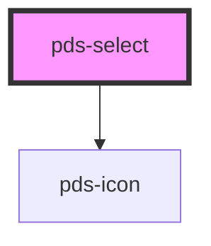

# pds-select

<!-- Auto Generated Below -->

## Properties

| Property                   | Attribute        | Description                                                                                                                                                                                                                               | Type                 | Default     |
| -------------------------- | ---------------- | ----------------------------------------------------------------------------------------------------------------------------------------------------------------------------------------------------------------------------------------- | -------------------- | ----------- |
| `autocomplete`             | `autocomplete`   | Specifies if and how the browser provides `autocomplete` assistance for the field.                                                                                                                                                        | `string`             | `undefined` |
| `componentId` _(required)_ | `component-id`   | A unique identifier used for the underlying component `id` attribute.                                                                                                                                                                     | `string`             | `undefined` |
| `disabled`                 | `disabled`       | Indicates whether or not the select field is disabled.                                                                                                                                                                                    | `boolean`            | `false`     |
| `errorMessage`             | `error-message`  | Displays an error message below the select and marks the select as invalid, with or without `invalid`.                                                                                                                                    | `string`             | `undefined` |
| `helperMessage`            | `helper-message` | Displays a message or hint below the select.                                                                                                                                                                                              | `string`             | `undefined` |
| `hideLabel`                | `hide-label`     | Visually hides the label text for instances where only the select should be displayed. Label remains accessible to assistive technology such as screen readers. Note: When true, the action slot is also hidden to maintain a minimal UI. | `boolean`            | `undefined` |
| `highlight`                | `highlight`      | Applies highlight styling to the select field.                                                                                                                                                                                            | `boolean`            | `undefined` |
| `invalid`                  | `invalid`        | Determines whether or not the select is invalid.                                                                                                                                                                                          | `boolean`            | `undefined` |
| `label`                    | `label`          | Text to be displayed as the select label.                                                                                                                                                                                                 | `string`             | `undefined` |
| `multiple`                 | `multiple`       | Indicates whether multiple options can be selected.                                                                                                                                                                                       | `boolean`            | `false`     |
| `name` _(required)_        | `name`           | Specifies the name. Submitted with the form name/value pair.                                                                                                                                                                              | `string`             | `undefined` |
| `required`                 | `required`       | Indicates whether or not the select field is required.                                                                                                                                                                                    | `boolean`            | `false`     |
| `value`                    | `value`          | The value(s) of the selected option(s).                                                                                                                                                                                                   | `string \| string[]` | `undefined` |

## Events

| Event             | Description                                                                                                                                                                                                                                               | Type                         |
| ----------------- | --------------------------------------------------------------------------------------------------------------------------------------------------------------------------------------------------------------------------------------------------------- | ---------------------------- |
| `pdsBlur`         | Emitted when the select loses focus.                                                                                                                                                                                                                      | `CustomEvent<FocusEvent>`    |
| `pdsFocus`        | Emitted when the select gains focus.                                                                                                                                                                                                                      | `CustomEvent<FocusEvent>`    |
| `pdsKeyDown`      | Emitted when a key is pressed down in the select.                                                                                                                                                                                                         | `CustomEvent<KeyboardEvent>` |
| `pdsSelectChange` | Emitted when the user changes the selection. `detail` is the native `change` event, so read the new value from the select's `value`: a string, or an array with `multiple`.  This event will not emit when programmatically setting the `value` property. | `CustomEvent<InputEvent>`    |

## Slots

| Slot          | Description                                                                      |
| ------------- | -------------------------------------------------------------------------------- |
| `"(default)"` | The `option` and `optgroup` elements to choose from. Other elements are ignored. |
| `"action"`    | Content to be displayed in the label area, typically for help icons or links     |

## Shadow Parts

| Part       | Description                                                                                                |
| ---------- | ---------------------------------------------------------------------------------------------------------- |
| `"action"` | Exposes the wrapper around the `action` slot for styling. Appears only when the `action` slot has content. |
| `"select"` | Exposes the native `select` element for styling.                                                           |

## Dependencies

### Depends on

- pds-icon

### Graph

----------------------------------------------

