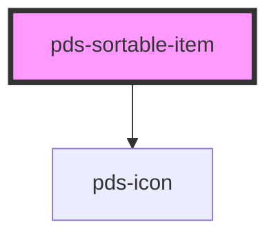

# pds-sortable-item

<!-- Auto Generated Below -->

## Properties

| Property        | Attribute        | Description                                                                                                                                                    | Type      | Default     |
| --------------- | ---------------- | -------------------------------------------------------------------------------------------------------------------------------------------------------------- | --------- | ----------- |
| `componentId`   | `component-id`   | A unique identifier used for the sortable item `id` attribute.                                                                                                 | `string`  | `undefined` |
| `enableActions` | `enable-actions` | Determines whether `sortable-item-actions` slot should be enabled.                                                                                             | `boolean` | `false`     |
| `itemLabel`     | `item-label`     | Name of the item in its reorder handle's label and in the reorder announcements. Pass a translated string to localize it; defaults to the item's text content. | `string`  | `undefined` |
| `showHandle`    | `show-handle`    | Determines whether `sortable-item` should have a handle.                                                                                                       | `boolean` | `false`     |

## Slots

| Slot                      | Description                                                                                                                             |
| ------------------------- | --------------------------------------------------------------------------------------------------------------------------------------- |
| `"sortable-item-actions"` | Content is placed within the `pds-sortable-item__actions` element as children. This slot is only rendered when `enable-actions` is set. |

## Dependencies

### Depends on

- pds-icon

### Graph

----------------------------------------------

