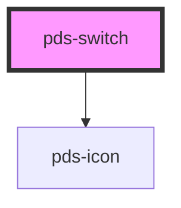

# pds-switch

<!-- Auto Generated Below -->

## Properties

| Property                   | Attribute         | Description                                                                                                                                                     | Type      | Default     |
| -------------------------- | ----------------- | --------------------------------------------------------------------------------------------------------------------------------------------------------------- | --------- | ----------- |
| `checked`                  | `checked`         | Determines the input 'checked' state.                                                                                                                           | `boolean` | `false`     |
| `componentId` _(required)_ | `component-id`    | A unique identifier used for the underlying component `id` attribute and the label `for` attribute.                                                             | `string`  | `undefined` |
| `disabled`                 | `disabled`        | Determines the input 'disabled' state, preventing user interaction.                                                                                             | `boolean` | `false`     |
| `errorMessage`             | `error-message`   | Displays an error message below the switch. It becomes the switch's accessible description only while `invalid` is set.                                         | `string`  | `undefined` |
| `helperMessage`            | `helper-message`  | Displays a message or hint below the switch.                                                                                                                    | `string`  | `undefined` |
| `hideLabel`                | `hide-label`      | Visually hides the label text for instances where only the switch should be displayed. Label remains accessible to assistive technology such as screen readers. | `boolean` | `undefined` |
| `invalid`                  | `invalid`         | Determines whether or not the switch is invalid.                                                                                                                | `boolean` | `false`     |
| `label`                    | `label`           | Text to be displayed as the switch label.                                                                                                                       | `string`  | `undefined` |
| `name`                     | `name`            | Specifies the name. Submitted with the form name/value pair when checked, or with `unchecked-value` while unchecked.                                            | `string`  | `undefined` |
| `required`                 | `required`        | Determines the 'required' state of the input.                                                                                                                   | `boolean` | `false`     |
| `uncheckedValue`           | `unchecked-value` | Provides a string submitted in form data under `name` while the switch is unchecked. When unset, an unchecked switch submits nothing, like a native checkbox.   | `string`  | `undefined` |
| `value`                    | `value`           | Provides input with a string submitted in form data.                                                                                                            | `string`  | `undefined` |

## Events

| Event             | Description                                                                                                                                                                                                                                | Type                      |
| ----------------- | ------------------------------------------------------------------------------------------------------------------------------------------------------------------------------------------------------------------------------------------ | ------------------------- |
| `pdsSwitchChange` | Emitted when the user toggles the switch, by a click or `Space`. `detail` is the native `change` event, so read the new state from the switch's `checked`.  This event will not emit when programmatically setting the `checked` property. | `CustomEvent<InputEvent>` |

## Slots

| Slot      | Description                                                                                         |
| --------- | --------------------------------------------------------------------------------------------------- |
| `"label"` | Content displayed as the switch label in place of the `label` text. Clicking it toggles the switch. |

## Dependencies

### Depends on

- pds-icon

### Graph

----------------------------------------------

