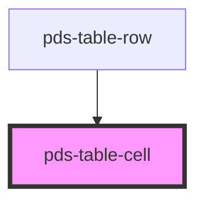

# pds-table-cell

<!-- Auto Generated Below -->

## Properties

| Property    | Attribute    | Description                                                                                                                                                                                                                                                                                               | Type                                        | Default     |
| ----------- | ------------ | --------------------------------------------------------------------------------------------------------------------------------------------------------------------------------------------------------------------------------------------------------------------------------------------------------- | ------------------------------------------- | ----------- |
| `cellAlign` | `cell-align` | Sets the text alignment within the cell.                                                                                                                                                                                                                                                                  | `"center" \| "end" \| "justify" \| "start"` | `undefined` |
| `truncate`  | `truncate`   | Truncates content to a max width and adds an ellipsis. When text overflows, a tooltip showing the full text will appear on hover/focus. Note: While the content is overflowing, the cell receives tabindex="0" so the tooltip can be reached by keyboard. Content that fits is left out of the tab order. | `boolean`                                   | `undefined` |

## Methods

### `rebindScrollListener() => Promise<void>`

Re-binds the scroll listener to the table's current responsive container. Called by
`pds-table` after a live `responsive` toggle: the cell stays in light DOM across that change,
so it never reconnects on its own and would otherwise keep listening to a container the
table already replaced or removed.

#### Returns

Type: `Promise<void>`

## Shadow Parts

| Part     | Description                                                                                                                                                                                                                                                                                                                                                                                                            |
| -------- | ---------------------------------------------------------------------------------------------------------------------------------------------------------------------------------------------------------------------------------------------------------------------------------------------------------------------------------------------------------------------------------------------------------------------- |
| `"cell"` | Set on the `pds-table-cell` element itself, so `::part(cell)` matches it only from a shadow root that contains it. Style `pds-table-cell` directly instead. In a `selectable` table, each row's selection cell sits in the row's shadow root: it has the `checkbox-cell` part when first rendered and `cell` after any re-render, so target both with `pds-table-row::part(checkbox-cell), pds-table-row::part(cell)`. |

## Dependencies

### Used by

 - [pds-table-row](../pds-table-row)

### Graph

----------------------------------------------

