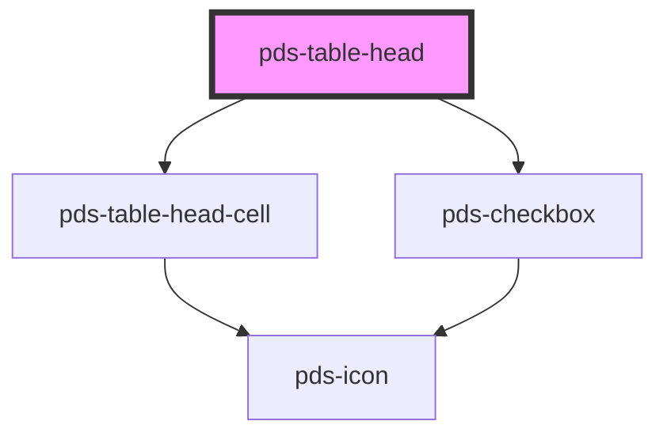

# pds-table-head

<!-- Auto Generated Below -->

## Properties

| Property        | Attribute       | Description                                                         | Type      | Default     |
| --------------- | --------------- | ------------------------------------------------------------------- | --------- | ----------- |
| `background`    | `background`    | Adds a subtle background color to the table head.                   | `boolean` | `false`     |
| `border`        | `border`        | Adds top and bottom borders to the table head.                      | `boolean` | `false`     |
| `indeterminate` | `indeterminate` | Determines if the select all checkbox is in an indeterminate state. | `boolean` | `undefined` |
| `isSelected`    | `is-selected`   | Determines if the select all checkbox is checked.                   | `boolean` | `undefined` |

## Events

| Event               | Description                                                                                                                                                                                                                                                           | Type                                    |
| ------------------- | --------------------------------------------------------------------------------------------------------------------------------------------------------------------------------------------------------------------------------------------------------------------- | --------------------------------------- |
| `pdsTableSelectAll` | Emitted when the user checks or unchecks the select-all checkbox, carrying the new state as `isSelected`. `pds-table` then sets `isSelected` on every row, and the rows don't emit `pdsTableRowSelected`. A head that starts with `isSelected` also emits it on load. | `CustomEvent<{ isSelected: boolean; }>` |

## Shadow Parts

| Part                    | Description                                                                                                                                                 |
| ----------------------- | ----------------------------------------------------------------------------------------------------------------------------------------------------------- |
| `"head"`                | Set on the `pds-table-head` element itself, so `::part(head)` matches it only from a shadow root that contains it. Style `pds-table-head` directly instead. |
| `"select-all-checkbox"` | Exposes the select-all checkbox for styling. Appears only when the table is `selectable` and `disableSelectAll` isn't set.                                  |

## Dependencies

### Depends on

- [pds-table-head-cell](../pds-table-head-cell)
- [pds-checkbox](../../pds-checkbox)

### Graph

----------------------------------------------

