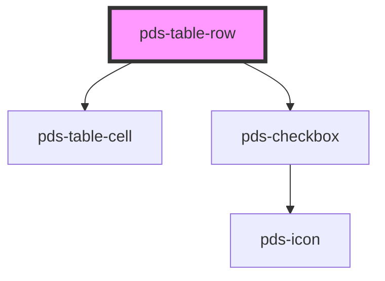

# pds-table-row

<!-- Auto Generated Below -->

## Properties

| Property        | Attribute       | Description                                                  | Type      | Default     |
| --------------- | --------------- | ------------------------------------------------------------ | --------- | ----------- |
| `indeterminate` | `indeterminate` | Determines if the row selected is in an indeterminate state. | `boolean` | `undefined` |
| `isSelected`    | `is-selected`   | Determines if the table row is currently selected.           | `boolean` | `undefined` |

## Events

| Event                 | Description                                                                                                                                                                                                                                                                                                                                                                                     | Type                                                      |
| --------------------- | ----------------------------------------------------------------------------------------------------------------------------------------------------------------------------------------------------------------------------------------------------------------------------------------------------------------------------------------------------------------------------------------------- | --------------------------------------------------------- |
| `pdsTableRowSelected` | Emitted when the user checks or unchecks the row's checkbox, carrying the new state as `isSelected` and the row's current position in `pds-table-body` as `rowIndex`, which changes when the table is sorted. A row that starts with `isSelected` also emits it on load.  This event will not emit when programmatically setting the `isSelected` property, or when select all changes the row. | `CustomEvent<{ rowIndex: number; isSelected: boolean; }>` |

## Shadow Parts

| Part             | Description                                                                                                                                              |
| ---------------- | -------------------------------------------------------------------------------------------------------------------------------------------------------- |
| `"row"`          | Set on the `pds-table-row` element itself, so `::part(row)` matches it only from a shadow root that contains it. Style `pds-table-row` directly instead. |
| `"row-checkbox"` | Exposes the row's selection checkbox for styling. Appears only when the table is `selectable`.                                                           |

## Dependencies

### Depends on

- [pds-table-cell](../pds-table-cell)
- [pds-checkbox](../../pds-checkbox)

### Graph

----------------------------------------------

