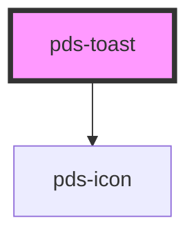

# pds-toast

<!-- Auto Generated Below -->

## Properties

| Property                   | Attribute        | Description                                                                                                                                                                                                                                                   | Type                                 | Default             |
| -------------------------- | ---------------- | ------------------------------------------------------------------------------------------------------------------------------------------------------------------------------------------------------------------------------------------------------------- | ------------------------------------ | ------------------- |
| `componentId` _(required)_ | `component-id`   | A unique identifier used for the underlying component `id` attribute.                                                                                                                                                                                         | `string`                             | `undefined`         |
| `dismissLabel`             | `dismiss-label`  | Accessible label for the dismiss button. Pass a translated string to localize it; defaults to English.                                                                                                                                                        | `string`                             | `'Dismiss message'` |
| `dismissible`              | `dismissible`    | Whether the toast can be dismissed manually via the close button. Note: This only controls manual dismissal. Auto-dismissal via duration still applies.                                                                                                       | `boolean`                            | `true`              |
| `duration`                 | `duration`       | The duration in milliseconds to show the toast before auto-dismissing. Set to 0 to disable auto-dismiss.                                                                                                                                                      | `number`                             | `4500`              |
| `icon`                     | `icon`           | The name of the icon to display in the toast.                                                                                                                                                                                                                 | `string`                             | `undefined`         |
| `severityLabel`            | `severity-label` | Accessible label announcing the toast's severity, read before the message. Pass a translated string to localize it; defaults to English (`Error`) for the `danger` type. Other types announce none unless this is set; pass an empty string to announce none. | `string`                             | `undefined`         |
| `type`                     | `type`           | The type of toast to display. - default: Grey background (default) - danger: Red background - loading: With spinner animation                                                                                                                                 | `"danger" \| "default" \| "loading"` | `'default'`         |

## Events

| Event               | Description                                                                  | Type                                     |
| ------------------- | ---------------------------------------------------------------------------- | ---------------------------------------- |
| `pdsToastDismissed` | Event emitted when the toast is dismissed, either manually or automatically. | `CustomEvent<{ componentId?: string; }>` |

## Methods

### `dismiss() => Promise<void>`

Dismisses the toast, as the dismiss button and `duration` do: plays the exit animation, then hides the toast and emits `pdsToastDismissed`.
Works even when `dismissible` is `false`. The toast stays in the DOM, hidden.

#### Returns

Type: `Promise<void>`

## Shadow Parts

| Part        | Description                                                                      |
| ----------- | -------------------------------------------------------------------------------- |
| `"dismiss"` | Exposes the dismiss button for styling. Appears unless `dismissible` is `false`. |

## Dependencies

### Depends on

- pds-icon

### Graph

----------------------------------------------

