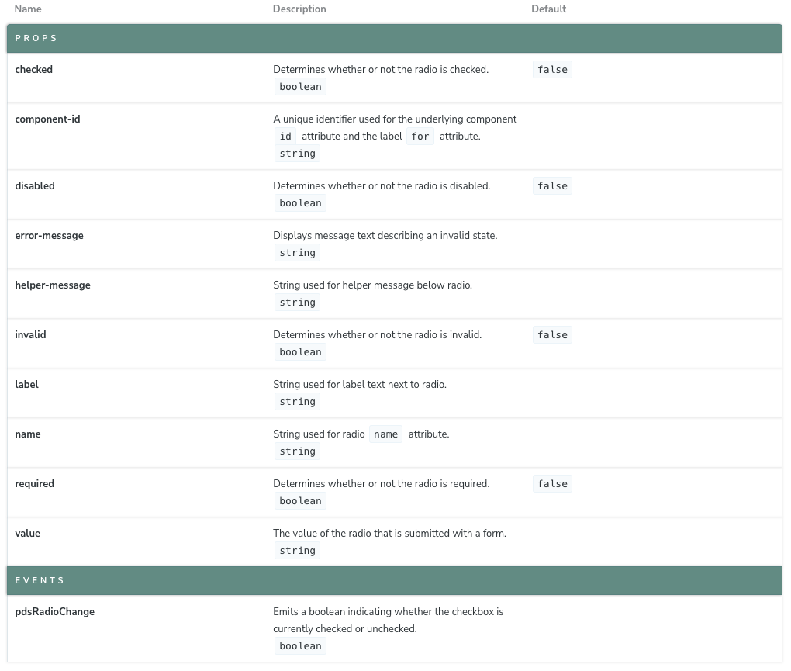
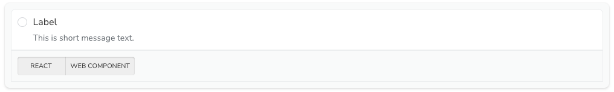
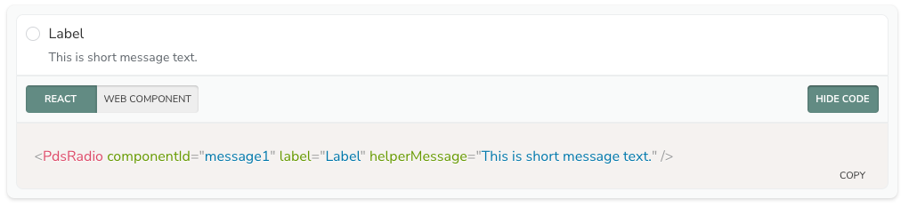

# Pine Doc Components

## Background

We started off using Storybook to document our [Stencil Web Components](https://stenciljs.com). With Stencil you have framework integrations or Output Targets, we were using React. Instead of having multiple versions of Storybook (WebComponents, React, etc), we elected to recreate the common components we used within Storybook (ArgsTable and Canvas).

## Components

### docArgsTable
The docArgsTable component can be used to show a static table of arg types for a given component as a way to document its interface.

### Properties

|name|description|
|---|----|
|docSource|The `docs-json` output type from Stencil.  During compiliation Stencil will generate a JSON file with all of the components metadata. You can read more about docs-json [here](https://stenciljs.com/docs/docs-json). It expects the `components` key.|
|componentName|The name of the component to lookup.|


### docCanvas
The Canvas component is a wrapper, featuring a series of buttons to view the various Source snippets.

#### Properties
|name|description|
|----|-----|
|mdxSource|An object of key/value pairs. Each key will render a button that will show the source code. Pine docs use `webComponent` and `react`.|
|display|The CSS `display` of the preview area: `block`, `inline`, `inline-block`, `flex` or `inline-flex`. Without it, the preview is `inline-flex` with a 20px gap.|

#### mdxSource strings are published to AI tools

The Pine MCP server, which serves Pine's docs to AI tools, takes each docCanvas's `webComponent` and `react` strings as the example code, as written. It only finds strings written as template literals (backticks). Keep every string complete and valid on its own:

- Close every custom element with its end tag, such as `<pds-radio ...></pds-radio>`. HTML doesn't self-close custom elements, so anything after `<pds-radio ... />` ends up inside it.
- Use only attributes and props the component has, with values it accepts.

### docTokenTable
The docTokenTable component renders a table of Pine design tokens from the `@kajabi-ui/styles` token JSON, with a preview, the CSS custom property name and the value of each token, plus a Description column when any token in the category has a description.

#### Properties
|name|description|
|----|-----|
|tier|`core` or `semantic`: which token JSON to read.|
|category|The token category to list, such as `color`, `dimension` or `font-size`.|
|use|Set to `spacing` with the `dimension` category to preview each token as the gap between two boxes.|

On `tier="semantic"`, the table adds a Dark column with each token's dark-mode value for the categories that have one.

## How to use


### docArgsTable
```javascript
import { DocArgsTable } from '@pine-ds/doc-components';
import { components } from '../../../../dist/docs.json';

<DocArgsTable componentName='pds-radio' docSource={components} />
```

**output**


### docCanvas

```javascript
import { DocCanvas } from '@pine-ds/doc-components';

<DocCanvas mdxSource={{
  react: `<PdsRadio componentId="message1" label="Label" helperMessage="This is short message text." />`,
  webComponent: `<pds-radio component-id="message1" label="Label" helper-message="This is short message text."></pds-radio>`
}}>
  <pds-radio component-id="message1" label="Label" helper-message="This is short message text." />
</DocCanvas>
```

**output**

Default state


Active Tab


### docTokenTable

```javascript
import { DocTokenTable } from '@pine-ds/doc-components';

<DocTokenTable category="color" tier="semantic" />
<DocTokenTable category="dimension" use="spacing" tier="core" />
```
